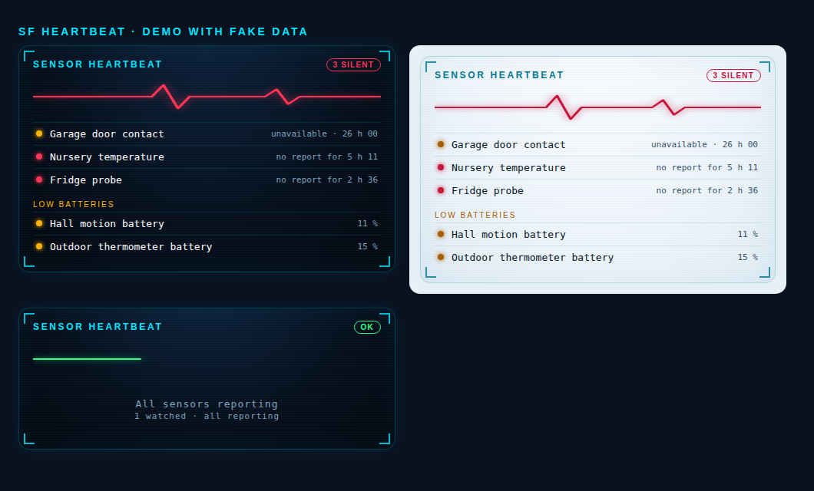

# SF Heartbeat

**Find the sensors that went quiet — before they cost you something.** A Lovelace card and two Home Assistant blueprints that catch the failure Home Assistant itself does not report: a sensor that is *still showing its last value* while the radio behind it is dead.

[](https://hacs.xyz)
[](https://khrom06.github.io/SF-Heartbeat/)
[](LICENSE)
[](https://my.home-assistant.io/redirect/hacs_repository/?owner=khrom06&repository=SF-Heartbeat&category=dashboard)

<p align="center"></p>

Same HUD look as [SF Cards](https://github.com/khrom06/SF-Cards): the cards sit side by side on one dashboard.

> **Why this exists.** A Zigbee thermometer stops reporting (coordinator radio stuck, dead router, flat battery). Home Assistant keeps the last value for hours and never shows `unavailable`, so no alert and no automation notices. The room can go cold or hot unseen. SF Heartbeat looks at **when the entity last reported**, not only at its state.

## What is in the box

| Piece | What it does |
|---|---|
| `sf-heartbeat-card` | Lists silent entities (no report for N hours, `unavailable`, or missing) and low batteries, with an ECG line that turns red. Tap a row for the usual more-info dialog. |
| Blueprint **silent sensor alert** | Runs *your* actions when watched sensors go silent, when they are all back, and optionally as a reminder. Fires once per episode. |
| Blueprint **graded repair** | Step 1 (e.g. restart the Zigbee radio) → wait → step 2 (e.g. restart Zigbee2MQTT) → wait → "repair failed" actions. Cooldown and single mode: it cannot loop. |

## Install

1. HACS → ⋮ → *Custom repositories* → add `https://github.com/khrom06/SF-Heartbeat`, category **Dashboard**; install.
2. Reload the browser. HACS registers the resource `/hacsfiles/SF-Heartbeat/sf-heartbeat.js` for you.
3. Blueprints (optional) — import with these buttons, or copy the files from `blueprints/automation/sf_heartbeat/`:

   [](https://my.home-assistant.io/redirect/blueprint_import/?blueprint_url=https%3A%2F%2Fgithub.com%2Fkhrom06%2FSF-Heartbeat%2Fblob%2Fmain%2Fblueprints%2Fautomation%2Fsf_heartbeat%2Fsilent_sensor_alert.yaml)
   [](https://my.home-assistant.io/redirect/blueprint_import/?blueprint_url=https%3A%2F%2Fgithub.com%2Fkhrom06%2FSF-Heartbeat%2Fblob%2Fmain%2Fblueprints%2Fautomation%2Fsf_heartbeat%2Fsilent_sensor_repair.yaml)

## The card

```yaml
type: custom:sf-heartbeat-card
title: Sensor heartbeat          # optional
watch:                           # entities that must keep reporting (staleness is only checked for these)
  - sensor.nursery_temperature
  - entity: sensor.fridge_probe  # per-entity limit
    max_silence: 6
max_silence: 2                   # hours, default for `watch`
scan_unavailable: true           # also list ANY entity that is currently unavailable (default true)
battery_threshold: 20            # % — list sensors with device_class battery at or below it (0 = off)
ignore: ["^sensor\\.test_", "_rssi$"]   # regular expressions, matched against the entity id
max_rows: 8
theme: auto                      # auto | dark | light
```

* **Silent** = unavailable / unknown / not found, or (for `watch`) no report for longer than `max_silence`.
* `scan_unavailable` skips domains that are unavailable by design (`update`, `button`, `device_tracker`, `person`…).
* Languages: en, fr, es, de, nl, it, pt, pl, ru, zh, ar (right-to-left for Arabic), the same eleven as SF Cards. The card follows the Home Assistant language; set `language: xx` on a card to force one.
* Cost: it re-renders only when the *set* of silent entities changes, plus a 60 s timer to keep the ages current. A busy instance does not make it redraw.

## The blueprints

**Silent sensor alert** — choose the entities, the maximum silence and a grace period, then add your own actions (mobile notification, TTS, persistent notification…). Inside the actions you get `event` (`silent`, `recovered`, `reminder`), `silent_count`, `silent_names` and `silent_list`:

```yaml
- action: notify.mobile_app_phone
  data:
    title: "{{ 'Sensors silent' if event == 'silent' else 'Sensors back' if event == 'recovered' else 'Still silent' }}"
    message: "{{ silent_names }}"
```

**Graded repair** — the same entity list, then up to three action blocks. Typical Zigbee setup: step 1 presses the coordinator's *restart radio* button, step 2 restarts the Zigbee2MQTT app (`hassio.addon_restart`/`app_restart`), the failure block sends a "needs a human" notification. After each step it waits and checks whether the sensors are back; if they are, it stops.

### Loop and spam safety (by design)

* Both blueprints use **template triggers**, which fire only when the condition changes from false to true — not on every evaluation.
* A configurable **grace period** (and a *recovery delay* before the "recovered" event) ignores the gaps that follow a Home Assistant or broker restart.
* The repair runs in `single` mode with a **cooldown** (default 3 h) checked before each run, so flapping sensors cannot trigger a restart loop.
* Nothing is sent or restarted unless *you* put it in an action block.

## Tests

```bash
./test/run.sh   # build check, 282 render checks in headless Chrome (all 11 languages, fake data) and offline blueprint checks
HA_URL=... HA_TOKEN=... python3 test/blueprint_templates.py   # optional: renders the blueprint templates on a real instance (read-only)
node test/e2e/heartbeat.mjs                                    # full run on a throw-away Home Assistant
```

The end-to-end test (also run in GitHub Actions, `ha-e2e.yml`, against the official container) creates both blueprints as automations on a real Home Assistant and makes a sensor go silent: a flap shorter than the grace period fires nothing, a real silence raises exactly one alert, the repair escalates step 1 → step 2 → failure, the cooldown blocks a second repair, a repair that works stops the escalation.

---

> **Made by Claude.** Designed and written by Claude (Anthropic's AI) working with its human partner. MIT licensed.
